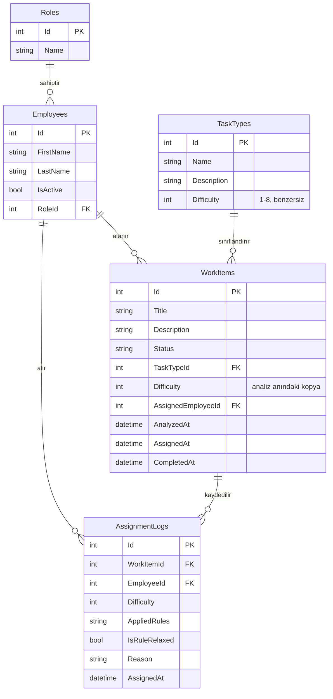
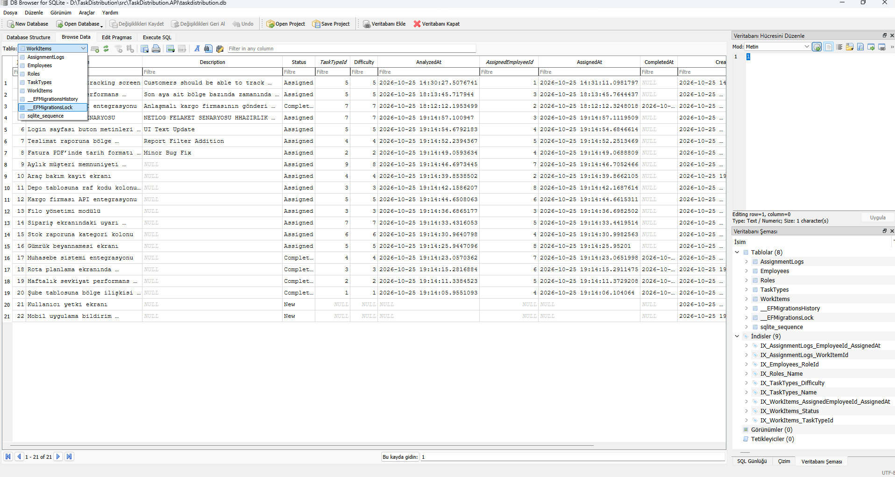
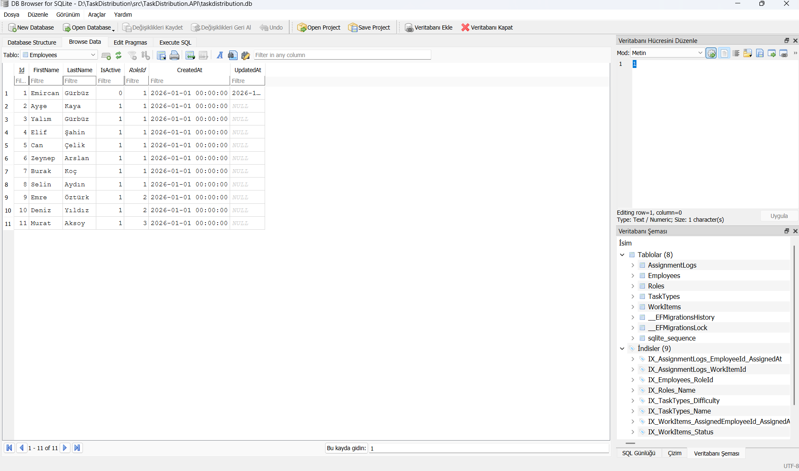
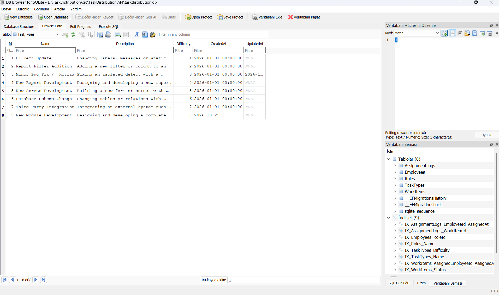
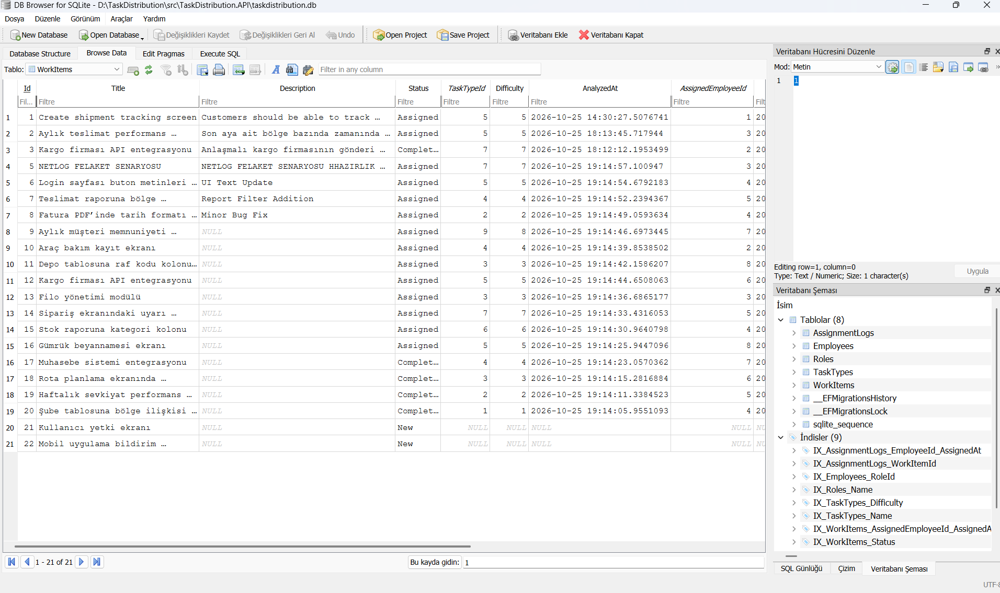
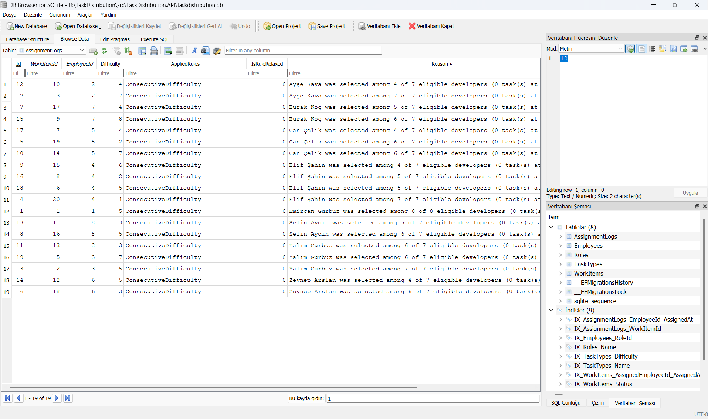
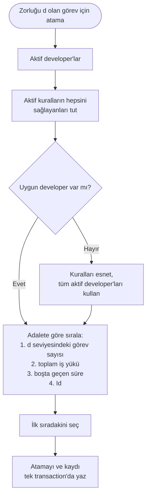
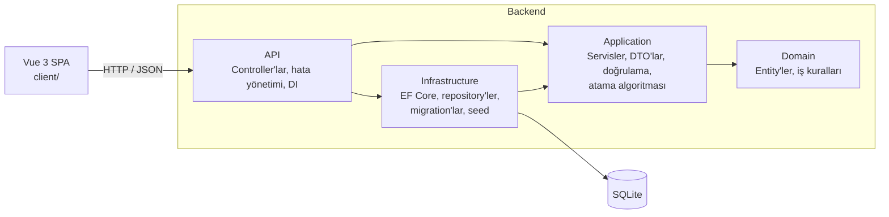

# TaskFlow · Adil Görev Dağıtım Sistemi

Bir yazılım biriminin günlük iş akışını dijitalleştiren web uygulaması. Kullanıcılar görev (work item) açar, analistler
görevin işlem tipini seçerek zorluk seviyesini belirler ve sistem, **ardışık zorlukta görev verilmemesi şartını gözeterek
en adil developer'ı otomatik olarak atar.**

**ASP.NET Core Web API (.NET 10)**, **EF Core (Code-First) + SQLite** ve **Vue 3** ile geliştirilmiş bir case study
projesidir.


---

## İçindekiler

1. [Özellikler](#özellikler)
2. [Kullanılan teknolojiler ve sürümler](#kullanılan-teknolojiler-ve-sürümler)
3. [Kurulum ve çalıştırma](#kurulum-ve-çalıştırma)
   - [Gereksinimler](#gereksinimler)
   - [1. Projeyi klonlama](#1-projeyi-klonlama)
   - [2. Backend'i (API) çalıştırma](#2-backendi-api-çalıştırma)
   - [3. Frontend'i (Vue) çalıştırma](#3-frontendi-vue-çalıştırma)
   - [Alternatif: Docker ile tek komutta çalıştırma](#alternatif-docker-ile-tek-komutta-çalıştırma)
   - [Sık karşılaşılan sorunlar](#sık-karşılaşılan-sorunlar)
4. [Veritabanı (SQLite)](#veritabanı-sqlite)
5. [Uygulamanın kullanımı](#uygulamanın-kullanımı)
6. [Atama algoritması](#atama-algoritması)
7. [Mimari](#mimari)
8. [API endpoint'leri](#api-endpointleri)
9. [Yapılandırma](#yapılandırma)
10. [Testler](#testler)
11. [Tasarım kararları](#tasarım-kararları)
12. [Ekran görüntüleri](#ekran-görüntüleri)

---

## Özellikler

- **Otomatik ve adil developer ataması:** Her görev, zorluk seviyesine göre en uygun developer'a atanır.
- **Yapılandırılabilir atama kuralları:** Case'teki belirsiz kuralın üç farklı yorumu, Strategy Pattern ile ayrı kurallar
  olarak yazıldı. Hangilerinin aktif olacağı ayarlardan seçilir.
- **Şeffaf kararlar:** Her atamada, developer'ın *neden* seçildiği kaydedilir ve ekranda gösterilir.
- **Fallback mekanizması:** Hiçbir developer kuralları sağlayamazsa sistem kilitlenmez, kuralları esnetip en adil kişiyi seçer.
- **Tam CRUD:** Personel, işlem tipi ve görevler için ekleme, listeleme, güncelleme ve silme. Doğrulama ve iş kuralı
  kontrolleriyle birlikte.
- **Görev yaşam döngüsü:** New (yeni) → Analyzed (analiz edildi) → Assigned (atandı) → Completed (tamamlandı)
- **Dashboard:** Developer bazında iş yükü grafiği, adalet endeksi ve zorluk seviyesine göre dağılım ısı haritası
- **Atama geçmişi:** Tüm atamalar ve her birinin gerekçesi
- **Otomatik veritabanı kurulumu:** Migration'lar ve başlangıç verileri uygulama açılırken otomatik uygulanır, elle
  çalıştırılması gereken bir komut yoktur.
- **50'den fazla birim testi:** 8 developer'a 160 görev dağıtıp dağılımın adil kaldığını kanıtlayan simülasyon testi dahil.

---

## Kullanılan teknolojiler ve sürümler

### Backend

| Teknoloji | Sürüm | Kullanım amacı |
|-----------|-------|----------------|
| .NET / C# | 10 (LTS) / C# 14 | Çalışma ortamı ve dil |
| ASP.NET Core Web API | 10 | Controller tabanlı REST API |
| Entity Framework Core | 10 | ORM, Code-First yaklaşımı ve migration'lar |
| SQLite | `Microsoft.EntityFrameworkCore.Sqlite` 10 | Dosya tabanlı veritabanı, sunucu kurulumu gerektirmez |
| FluentValidation | 12 | İstek (request) doğrulama |
| Swashbuckle (Swagger) | 10.3 | API dokümantasyonu ve test arayüzü |
| xUnit | 2.9 | Birim testleri |

### Frontend

| Teknoloji | Sürüm | Kullanım amacı |
|-----------|-------|----------------|
| Vue | 3.5 | Arayüz framework'ü (Composition API, `<script setup>`) |
| Vite | 8 | Geliştirme sunucusu ve derleme aracı |
| Vue Router | 4 | Sayfalar arası geçiş |
| Pinia | 3 | Durum yönetimi (bildirimler) |
| Axios | 1 | HTTP istemcisi |
| Bootstrap | 5.3 (sadece CSS) | Temel stiller, üzerine özel tema |
| Bootstrap Icons | 1 | İkonlar |
| Chart.js + vue-chartjs | 4 + 5 | Dashboard grafikleri |

### Geliştirme araçları

| Araç | Sürüm |
|------|-------|
| .NET SDK | 10.0.100 veya üzeri |
| Node.js | 24 LTS (22.18 ve üzeri de çalışır) |
| Docker (isteğe bağlı) | Docker Desktop, Compose v2 ile |

> Paketlerin kesin sürümleri `.csproj` dosyalarında ve `client/package-lock.json` dosyasında sabitlenmiştir.

---

## Kurulum ve çalıştırma

Proje iki parçadan oluşur ve **ikisinin de aynı anda çalışıyor olması gerekir:**

| Parça | Klasör | Adres |
|-------|--------|-------|
| **Backend** (ASP.NET Core Web API) | `src/` | http://localhost:5080 |
| **Frontend** (Vue 3) | `client/` | http://localhost:5173 |

Veritabanı için ayrıca bir şey kurmanıza gerek yoktur. SQLite veritabanı, backend ilk kez açıldığında otomatik olarak
oluşturulur.

### Gereksinimler

| Gereksinim | İndirme adresi | Kontrol komutu |
|------------|----------------|----------------|
| .NET 10 SDK | https://dotnet.microsoft.com/download/dotnet/10.0 | `dotnet --version` → `10.0.x` |
| Node.js 24 LTS | https://nodejs.org | `node -v` → `v24.x` |
| Git | https://git-scm.com | `git --version` |

Sürümleri kontrol etmek için bir terminal (PowerShell, CMD veya Terminal) açıp şu komutları çalıştırın:

```bash
dotnet --version
node -v
git --version
```

> Bilgisayarınızda .NET veya Node.js kurmak istemiyorsanız [Docker ile çalıştırma](#alternatif-docker-ile-tek-komutta-çalıştırma)
> bölümüne geçebilirsiniz.

### 1. Projeyi klonlama

Projeyi indirmek istediğiniz klasörde bir terminal açın ve şunları çalıştırın:

```bash
git clone https://github.com/<kullanici-adi>/TaskDistribution.git
cd TaskDistribution
```

Klonlama sonrasında klasör yapısı şöyle olmalıdır:

```
TaskDistribution/
├── client/                  ← Frontend (Vue 3)
├── src/                     ← Backend (.NET 10)
├── tests/                   ← Birim testleri
├── docs/                    ← Flowchart ve ekran görüntüleri
├── TaskDistribution.sln
└── README.md
```

### 2. Backend'i (API) çalıştırma

Backend'i iki farklı şekilde çalıştırabilirsiniz.

#### Seçenek A: Terminal ile

Projenin kök klasöründe (`TaskDistribution.sln` dosyasının olduğu yer) şu komutu çalıştırın:

```bash
dotnet run --project src/TaskDistribution.API --launch-profile http
```

İlk çalıştırmada NuGet paketleri indirileceği için birkaç dakika sürebilir. Terminalde şu satırı gördüğünüzde API hazırdır:

```
Now listening on: http://localhost:5080
```

**Bu terminali kapatmayın**, API çalışmaya devam etmelidir.

#### Seçenek B: Visual Studio ile

1. `TaskDistribution.sln` dosyasını Visual Studio 2026 (veya güncel Visual Studio 2022) ile açın.
2. Solution Explorer'da `TaskDistribution.API` projesine sağ tıklayıp **Set as Startup Project** seçin.
3. Üst araç çubuğundaki çalıştır butonunun yanındaki listeden **http** profilini seçin.
4. **Ctrl+F5** (Start Without Debugging) ile çalıştırın.

> **F5 yerine Ctrl+F5 kullanmanızı öneririz.** Uygulama, kullanıcıya anlaşılır hata mesajı döndürmek için iş kuralı
> exception'ları fırlatır (örneğin görevi olan bir personeli silmeye çalışmak). Debug modunda (F5) Visual Studio bu
> exception'larda programı durdurur ve frontend'deki istek zaman aşımına düşer.

#### Backend'in çalıştığını kontrol edin

Tarayıcıda şu adresi açın: **http://localhost:5080/swagger**

Swagger sayfası açılıyorsa backend çalışıyor demektir. Bu sayfadan tüm API endpoint'lerini arayüz olmadan da
deneyebilirsiniz.

İlk çalıştırmada arka planda şunlar otomatik olarak gerçekleşir:

1. `src/TaskDistribution.API/taskdistribution.db` adında bir SQLite veritabanı dosyası oluşturulur.
2. Tüm migration'lar uygulanır ve tablolar oluşturulur.
3. Başlangıç verileri (roller, 11 personel, 8 işlem tipi) eklenir.

`dotnet ef database update` gibi bir komut çalıştırmanıza **gerek yoktur.**

### 3. Frontend'i (Vue) çalıştırma

Backend çalışırken **yeni bir terminal** açın ve şunları çalıştırın:

```bash
cd client
npm ci
npm run dev
```

| Komut | Ne yapar? |
|-------|-----------|
| `cd client` | Frontend klasörüne geçer. |
| `npm ci` | `package-lock.json` dosyasındaki sürümlerle bağımlılıkları kurar. Sadece ilk seferde gerekir. |
| `npm run dev` | Geliştirme sunucusunu başlatır. |

Terminalde şu satırı gördüğünüzde frontend hazırdır:

```
➜  Local:   http://localhost:5173/
```

Tarayıcıda **http://localhost:5173** adresini açın. Dashboard sayfası açılmalıdır.

> Frontend, API adresini `client/.env.development` dosyasından okur (`VITE_API_BASE_URL=http://localhost:5080/api`).
> Backend, bu adresten gelen isteklere CORS ayarıyla izin verir.

#### Özet: Uygulamayı her açışınızda

| Terminal | Klasör | Komut |
|----------|--------|-------|
| 1 | `TaskDistribution/` | `dotnet run --project src/TaskDistribution.API --launch-profile http` |
| 2 | `TaskDistribution/client/` | `npm run dev` |

Ardından tarayıcıda http://localhost:5173 adresini açın. Durdurmak için her iki terminalde de **Ctrl+C** tuşlarına basın.

### Alternatif: Docker ile tek komutta çalıştırma

Bu yöntemde bilgisayarınızda .NET veya Node.js kurulu olmasına gerek yoktur, sadece
[Docker Desktop](https://www.docker.com/products/docker-desktop/) yeterlidir.

Docker Desktop açıkken projenin kök klasöründe şu komutu çalıştırın:

```bash
docker compose up --build
```

İlk derleme birkaç dakika sürer. Tamamlandığında:

| Ne | Adres |
|----|-------|
| Web uygulaması | http://localhost:8080 |
| Swagger (API) | http://localhost:5080/swagger |

Docker kurulumunda iki container çalışır:

```
Tarayıcı ──► localhost:8080 ──► [client: nginx]
                                  ├── Vue dosyalarını sunar
                                  └── /api isteklerini ──► [api: .NET 10] ──► SQLite (Docker volume)
```

Veritabanı bir Docker volume'unda saklandığı için container'lar kapatılıp açıldığında veriler kaybolmaz.

```bash
docker compose down        # Container'ları durdurur, veriler korunur
docker compose down -v     # Container'ları durdurur ve veritabanını siler
```

### Sık karşılaşılan sorunlar

| Sorun | Çözüm |
|-------|-------|
| `A compatible .NET SDK was not found` | .NET 10 SDK kurulu değil. Gereksinimler bölümündeki adresten kurun. |
| Frontend'de *"The server could not be reached"* mesajı | Backend çalışmıyor. Backend terminalinin açık olduğunu ve http://localhost:5080/swagger adresinin açıldığını kontrol edin. |
| Frontend'de *"The server took too long to respond"* mesajı | Backend Visual Studio'da **F5** ile çalıştırılmış ve bir exception'da durmuş. **Ctrl+F5** ile çalıştırın. |
| Tarayıcı konsolunda `blocked by CORS policy` hatası | Frontend'i `http://localhost:5173` adresinden açtığınızdan emin olun. `127.0.0.1` farklı bir adres sayılır. |
| `npm run dev` çalışırken `Cannot find native binding` hatası | Node.js sürümü eski. Node.js 24 LTS kurun, ardından `client` klasöründe `node_modules` klasörünü silip `npm ci` komutunu tekrar çalıştırın. |
| `Port 5173 is already in use` | Başka bir Vite uygulaması açık. Onu kapatın. Backend'deki CORS ayarı sadece bu porta izin verdiği için port değiştirilmemelidir. |
| Veritabanını sıfırlamak istiyorum | Backend'i durdurun, `src/TaskDistribution.API/taskdistribution.db` dosyasını silin ve backend'i tekrar başlatın. Veritabanı başlangıç verileriyle yeniden oluşturulur. |

---

## Veritabanı (SQLite)

### Neden SQLite?

[SQLite](https://www.sqlite.org), tüm veritabanını **tek bir dosyada** tutan, sunucu gerektirmeyen bir veritabanıdır.
Case study'de de belirtildiği gibi sunucu yazılımı ve yapılandırma gerektirmediği için tercih edildi:

- Projeyi klonlayan herkes, hiçbir veritabanı kurulumu yapmadan uygulamayı çalıştırabilir.
- SQL Server veya PostgreSQL gibi bir sunucuya, kullanıcı adına veya şifreye ihtiyaç yoktur.
- Repository'de gizli bir connection string veya şifre bulunmaz.

Uygulama **Entity Framework Core** üzerinden veritabanına eriştiği için, ileride SQL Server veya PostgreSQL'e geçmek
sadece `Infrastructure` katmanında sağlayıcının (provider) değiştirilmesiyle mümkündür. Diğer katmanlar veritabanı
türünü bilmez.

### Veritabanı nerede?

| Çalıştırma şekli | Dosya konumu |
|------------------|--------------|
| Terminal veya Visual Studio | `src/TaskDistribution.API/taskdistribution.db` |
| Docker | `api-data` adlı Docker volume'u (`/app/data/taskdistribution.db`) |

Veritabanı dosyası `.gitignore` ile repository'nin dışında tutulur. Her makinede migration'lar ile yeniden oluşturulur.

### Code-First yaklaşımı

Tablolar elle oluşturulmadı. C# sınıflarından (entity) **Code-First** yaklaşımıyla üretildi:

1. `Domain/Entities` klasöründeki sınıflar tabloların karşılığıdır.
2. `Infrastructure/Persistence/Configurations` klasöründeki Fluent API sınıfları kolon uzunluklarını, ilişkileri,
   index'leri ve kısıtları (constraint) tanımlar.
3. `Infrastructure/Persistence/Migrations` klasöründeki migration dosyaları, bu tanımlardan üretilmiş SQL adımlarıdır.
4. `Infrastructure/Persistence/Seed/SeedData.cs` başlangıç verilerini içerir. Bu veriler de migration'ın bir parçasıdır.

### Tablolar

| Tablo | Açıklama | Önemli kurallar |
|-------|----------|-----------------|
| `Roles` | Roller: Developer, Analyst, Manager | Rol adı benzersiz |
| `Employees` | Personel (ad, soyad, rol, aktiflik durumu) | Personeli olan rol silinemez |
| `TaskTypes` | 8 işlem tipi ve zorlukları | Zorluk 1–8 arasında olmalı (check constraint) ve her işlem tipinin zorluğu farklı olmalı (unique index) |
| `WorkItems` | Görevler: başlık, durum, işlem tipi, zorluk, atanan kişi ve tarihler | Durum metin olarak saklanır (`Assigned` gibi). Atama sorguları için `(AssignedEmployeeId, AssignedAt)` index'i vardır. |
| `AssignmentLogs` | Her atamanın kaydı: kime atandı, hangi kurallar uygulandı, kural esnetildi mi, gerekçe | Görev silinirse kaydı da silinir (cascade) |
| `__EFMigrationsHistory` | EF Core'un hangi migration'ların uygulandığını takip ettiği tablo | EF Core tarafından otomatik yönetilir |

Tüm tablolarda `CreatedAt` ve `UpdatedAt` kolonları vardır. Bu kolonlar bir EF Core interceptor'ı tarafından otomatik
doldurulur.

### Veri modeli



### Başlangıç verileri (seed)

| Veri | İçerik |
|------|--------|
| Roller | Developer, Analyst, Manager |
| Personel | 8 developer, 2 analist, 1 yönetici |
| İşlem tipleri | Her biri farklı zorlukta 8 işlem tipi (1–8) |

### Veritabanını görüntüleme

Veritabanını incelemek için ücretsiz [DB Browser for SQLite](https://sqlitebrowser.org) uygulaması kullanılabilir:

1. DB Browser for SQLite'ı açın.
2. **Open Database** butonuna basıp `src/TaskDistribution.API/taskdistribution.db` dosyasını seçin.
3. **Database Structure** sekmesinde tabloları ve kolonları, **Browse Data** sekmesinde kayıtları görebilirsiniz.

> Veritabanını uygulama çalışırken **sadece okumak** için açın. Değişiklik yapıp kaydederseniz uygulamanın kayıtlarıyla
> çakışabilir.

#### Tablo yapısı



#### Örnek veriler

| Employees | TaskTypes |
|-----------|-----------|
|  |  |

| WorkItems | AssignmentLogs |
|-----------|----------------|
|  |  |

---

## Uygulamanın kullanımı

1. **Work items → New work item:** Başlık ve açıklama ile yeni bir görev oluşturun. Görevin durumu *New* olur.
2. **Analyze:** Analist bir işlem tipi seçer. O işlem tipinin zorluğu göreve kopyalanır ve durum *Analyzed* olur.
3. **Assign** (veya tek adımda **Analyze and assign**): Sistem en adil developer'ı seçer ve **neden o kişiyi
   seçtiğini** gösterir. Durum *Assigned* olur.
4. **Complete:** Developer işi bitirdiğinde görev tamamlanır.
5. Dağılımı **Dashboard** ekranından, tüm geçmişi **Assignments** ekranından takip edebilirsiniz.

Personel ve işlem tipleri kendi ekranlarından yönetilir. Görev almış bir personel silinemez, çünkü kaydı dağıtım
geçmişinin bir parçasıdır. Bunun yerine uygulama personeli **pasif yapmayı** önerir. Pasif personel otomatik atama
havuzuna dahil edilmez.

---

## Atama algoritması

> Ayrıntılı flowchart: [docs/assignment-algorithm.md](docs/assignment-algorithm.md)
> · Görsel olarak: [docs/assignment-algorithm.png](docs/assignment-algorithm.png)

### Kuralın yorumlanması

Case study'de görevlerin zorluk seviyesine göre adil dağıtılması, *"görevlerin ardışık zorlukta developerlara
atanmaması şartı ile"* isteniyor. Bu cümle birden fazla şekilde yorumlanabildiği için üç olası yorumun **üçü de**
`IAssignmentRule` arayüzünü uygulayan ayrı kurallar olarak yazıldı:

| Kural | Anahtar | Anlamı | Varsayılan |
|-------|---------|--------|------------|
| A | `ConsecutiveDifficulty` | Bir developer'a, son aldığı görevin zorluğuna komşu (±1) seviyede görev verilmez. Son görevi 5 ise 4 ve 6 verilemez. | **Açık** |
| B | `ConsecutiveAssignment` | Son görevi alan developer, bir sonraki görevi alamaz. | Kapalı |
| C | `ConsecutiveHardTask` | Son görevi zor (≥ 6) olan developer'a yeniden zor görev verilmez. | Kapalı |

**Kural A varsayılan olarak açıktır**, çünkü cümlenin en doğrudan okuması budur. Kurallar birlikte de kullanılabilir ve
kod değiştirmeden `appsettings.json` dosyasından açılıp kapatılır. Yeni bir yorum eklemek için `IAssignmentRule`
arayüzünü uygulayan yeni bir sınıf yazmak yeterlidir (Open/Closed Principle).

### Adımlar

Zorluğu **d** olan analiz edilmiş bir görev için:

1. **Aday havuzu:** Rolü *Developer* olan aktif personel.
2. **Kural filtresi:** Aktif kuralların **hepsini** sağlayan developer'lar kalır.
3. **Adalet sıralaması** (eşitlik durumunda bir sonraki kritere geçilir):
   1. **d** seviyesinde en az görev almış olan (seviye bazında adalet)
   2. Toplam iş yükü (aldığı görevlerin zorluk toplamı) en düşük olan
   3. En uzun süredir görev almamış olan (hiç görev almamış olan en öndedir)
   4. Id'si en küçük olan (aynı girdi her zaman aynı sonucu versin diye)
4. **Fallback:** Kural filtresinden kimse geçemezse kurallar esnetilir ve aynı sıralama tüm aktif developer'lara
   uygulanır. Atama kaydı `IsRuleRelaxed = true` olarak işaretlenir.
5. **Kayıt:** Görevin güncellenmesi ve atama kaydının yazılması **tek bir transaction** içinde yapılır.

Her atama, okunabilir bir gerekçeyle birlikte döner. Örnek:

> *Ayşe Kaya was selected among 7 of 8 eligible developers (0 task(s) at level 4, total workload 0,
> no previous assignments).*
>
> *(Ayşe Kaya, uygun 8 developer'dan 7'si arasından seçildi: 4. seviyede 0 görev, toplam iş yükü 0, daha önce görev almadı.)*



### Adaletin ölçülmesi

Dashboard, aktif developer'ların toplam iş yükü üzerinden **Jain's fairness index** (Jain adalet endeksi) değerini gösterir:

```
J = (x₁ + x₂ + … + xₙ)² / (n · (x₁² + x₂² + … + xₙ²))
```

Burada `x` her developer'ın toplam iş yükü, `n` developer sayısıdır.

| Durum | Sonuç |
|-------|-------|
| Herkes aynı yükü taşıyor | **%100** |
| Tüm işi tek kişi yapıyor | **1/n** (8 developer için %12,5) |

Dashboard ayrıca her zorluk seviyesinde en çok ve en az görev alan developer arasındaki en büyük farkı da gösterir.

---

## Mimari

Backend **katmanlı mimari** (Clean / Onion Architecture) ile kurulmuştur. Bağımlılıklar içe doğrudur: Domain katmanı
veritabanını, web'i veya herhangi bir framework'ü bilmez.



| Proje | Sorumluluğu | Bağımlı olduğu |
|-------|-------------|----------------|
| `TaskDistribution.Domain` | Entity'ler, enum'lar, iş kuralları (`WorkItem.Analyze`, `AssignTo`, `Complete`) | – |
| `TaskDistribution.Application` | Servisler, DTO'lar, validator'lar, repository arayüzleri, atama kuralları ve seçici | Domain |
| `TaskDistribution.Infrastructure` | `DbContext`, Fluent API eşlemeleri, repository'ler, Unit of Work, migration'lar, seed | Application |
| `TaskDistribution.API` | REST controller'lar, global hata yönetimi, CORS, Swagger, bağımlılıkların kaydı | Application, Infrastructure |
| `TaskDistribution.Tests` | Kurallar, seçici, adalet hesaplaması ve domain için birim testleri | Application, Domain |
| `client` | Vue 3 tek sayfa uygulaması (SPA) | API (HTTP üzerinden) |

### Klasör yapısı

```
TaskDistribution/
├── src/
│   ├── TaskDistribution.Domain/
│   │   ├── Common/              BaseEntity
│   │   ├── Constants/           DifficultyLevel, RoleNames
│   │   ├── Entities/            Role, Employee, TaskType, WorkItem, AssignmentLog
│   │   ├── Enums/               WorkItemStatus
│   │   └── Exceptions/          DomainException
│   ├── TaskDistribution.Application/
│   │   ├── Abstractions/        IRepository<T>, özel repository'ler, IUnitOfWork
│   │   ├── Common/              NotFoundException, ConflictException
│   │   └── Features/
│   │       ├── Assignments/     Kurallar, seçici, ayarlar, atama servisleri
│   │       ├── Dashboard/       İstatistikler, FairnessCalculator
│   │       ├── Employees/       DTO'lar, validator'lar, servis
│   │       ├── Roles/
│   │       ├── TaskTypes/
│   │       └── WorkItems/
│   ├── TaskDistribution.Infrastructure/
│   │   └── Persistence/         DbContext, Configurations, Migrations, Repositories, Seed, Interceptors
│   └── TaskDistribution.API/
│       ├── Controllers/
│       └── ExceptionHandling/
├── tests/TaskDistribution.Tests/
├── client/
│   └── src/
│       ├── api/                 HTTP istemcisi ve her kaynak için bir modül
│       ├── components/          Ortak ve ekrana özel bileşenler
│       ├── stores/              Pinia store'ları
│       ├── utils/               Biçimlendirme ve yardımcı fonksiyonlar
│       └── views/               Sayfalar
├── docs/                        Flowchart ve ekran görüntüleri
└── docker-compose.yml
```

### Kullanılan prensipler ve pattern'ler

| Prensip / pattern | Nerede kullanıldı? |
|-------------------|--------------------|
| **Katmanlı mimari** | Bağımlılıkları içe doğru olan dört backend projesi |
| **Repository Pattern** | Ortak işlemler için generic `IRepository<T>`, `Include` gerektiren sorgular için özel repository'ler |
| **Unit of Work** | Kaydetme ve transaction için `IUnitOfWork`. Tüm repository'ler aynı scoped `DbContext`'i paylaşır. |
| **Strategy Pattern** | `IAssignmentRule` arayüzü ve birbirinin yerine kullanılabilen üç kural |
| **Single Responsibility** | Kurallar sadece kontrol eder, seçici sadece seçer, servis sadece koordine eder. |
| **Open/Closed** | Yeni kural veya entity eşlemesi mevcut koda dokunmadan eklenir. |
| **Liskov Substitution** | Herhangi bir `IAssignmentRule` veya repository implementasyonu bir diğerinin yerine geçebilir. |
| **Interface Segregation** | Servisler sadece kullandıkları repository'lere bağımlıdır. `IUnitOfWork` repository'leri dışarı açmaz. |
| **Dependency Inversion** | Arayüzler Application'da tanımlanır, Infrastructure bunları uygular. DI ile birbirine bağlanır. |
| **Zengin domain modeli** | `WorkItem` durumunu private setter'lar ve kontrollü metotlarla korur. |
| **Code-First** | Fluent API eşlemeleri, migration'lar ve seed verileri `Infrastructure/Persistence` altında |

---

## API endpoint'leri

Tüm endpoint'ler JSON döner. Hatalar standart [ProblemDetails](https://www.rfc-editor.org/rfc/rfc9457) formatındadır.
Tüm endpoint'leri **http://localhost:5080/swagger** adresinden deneyebilirsiniz.

| Metot | Endpoint | Açıklama |
|-------|----------|----------|
| GET | `/api/roles` | Rolleri listeler |
| GET | `/api/employees` | Personeli listeler |
| GET | `/api/employees/{id}` | Bir personeli getirir |
| POST | `/api/employees` | Personel ekler |
| PUT | `/api/employees/{id}` | Personeli günceller (aktif/pasif yapma dahil) |
| DELETE | `/api/employees/{id}` | Görevi olmayan personeli siler |
| GET | `/api/task-types` | İşlem tiplerini listeler |
| GET | `/api/task-types/{id}` | Bir işlem tipini getirir |
| POST | `/api/task-types` | İşlem tipi ekler |
| PUT | `/api/task-types/{id}` | İşlem tipini günceller |
| DELETE | `/api/task-types/{id}` | Kullanılmayan işlem tipini siler |
| GET | `/api/work-items?status=` | Görevleri listeler, isteğe bağlı olarak duruma göre filtreler |
| GET | `/api/work-items/{id}` | Bir görevi getirir |
| POST | `/api/work-items` | Görev ekler |
| PUT | `/api/work-items/{id}` | Görevin başlık ve açıklamasını günceller |
| POST | `/api/work-items/{id}/analyze` | İşlem tipini ve zorluğu belirler |
| POST | `/api/work-items/{id}/assign` | **En adil developer'ı atar** |
| POST | `/api/work-items/{id}/complete` | Atanmış görevi tamamlar |
| DELETE | `/api/work-items/{id}` | Yeni veya analiz edilmiş görevi siler |
| GET | `/api/assignments/rules` | Atama kurallarını ve açık olup olmadıklarını listeler |
| GET | `/api/assignments/logs?count=` | Son atamaların geçmişini getirir |
| GET | `/api/dashboard` | İş yükü istatistiklerini ve adalet endeksini getirir |

| HTTP kodu | Ne zaman döner? |
|-----------|-----------------|
| 400 | Doğrulama hatası veya iş kuralı ihlali (örneğin atanmış bir görevi yeniden analiz etmek) |
| 404 | İstenen kayıt bulunamadı |
| 409 | Çakışma (örneğin görevi olan personeli silmek veya aynı zorlukta ikinci bir işlem tipi eklemek) |

Hazır istek örnekleri `src/TaskDistribution.API/TaskDistribution.API.http` dosyasındadır. Visual Studio ve VS Code
bu istekleri doğrudan gönderebilir.

---

## Yapılandırma

Ayarlar `src/TaskDistribution.API/appsettings.json` dosyasındadır:

```json
{
  "ConnectionStrings": {
    "DefaultConnection": "Data Source=taskdistribution.db"
  },
  "Assignment": {
    "EnabledRules": [ "ConsecutiveDifficulty" ],
    "HardTaskThreshold": 6
  },
  "Cors": {
    "AllowedOrigins": [ "http://localhost:5173" ]
  }
}
```

| Ayar | Açıklama |
|------|----------|
| `ConnectionStrings:DefaultConnection` | SQLite dosyası. Göreli bir yol verilirse API projesinin klasörüne göre çözümlenir. |
| `Assignment:EnabledRules` | Açık olan kuralların anahtarları: `ConsecutiveDifficulty`, `ConsecutiveAssignment`, `ConsecutiveHardTask`. Birden fazlası birlikte kullanılabilir. |
| `Assignment:HardTaskThreshold` | Kural C'nin "zor" kabul ettiği en düşük zorluk seviyesi |
| `Cors:AllowedOrigins` | Tarayıcıdan API'ye istek gönderebilecek adresler |

Atama ayarları `IOptionsMonitor` ile okunduğu için **API çalışırken yapılan değişiklikler yeniden başlatmaya gerek
kalmadan devreye girer.** Örneğin A ve C kurallarını birlikte açmak için:

```json
"EnabledRules": [ "ConsecutiveDifficulty", "ConsecutiveHardTask" ]
```

---

## Testler

Projenin kök klasöründe:

```bash
dotnet test
```

| Test sınıfı | Neyi kanıtlıyor? |
|-------------|------------------|
| `ConsecutiveDifficultyRuleTests` | Komşu zorluklar elenir, diğerleri geçer. 1↔2 ve 7↔8 gibi sınır değerler dahil. |
| `ConsecutiveAssignmentRuleTests` | Son görevi alan developer elenir. |
| `ConsecutiveHardTaskRuleTests` | Art arda zor görev engellenir ve eşik değeri ayarlanabilir. |
| `FairDeveloperSelectorTests` | Her adalet kriteri, kural filtresi, fallback ve gerekçe metni |
| `DeveloperCandidateBuilderTests` | İstatistiklerin atama geçmişinden doğru hesaplanması |
| `AssignmentSimulationTests` | 8 developer'a 160 görev dağıtıldığında hiçbir aktif kural ihlal edilmez ve seviye bazındaki fark 2'yi geçmez. |
| `FairnessCalculatorTests` | Jain adalet endeksi ve seviye bazında fark hesabı |
| `WorkItemTests` | Görevin yaşam döngüsü ve kuralları |

Seçici ve kurallar veritabanı veya framework bağımlılığı olmayan saf sınıflar olduğu için testlerde mock kullanılmaz
ve testler milisaniyeler içinde çalışır.

---

## Tasarım kararları

| Karar | Gerekçe |
|-------|---------|
| **SQLite** | Veritabanı sunucusu veya kurulum gerektirmez. Projeyi klonlayan herkes doğrudan çalıştırabilir. |
| **`Task` yerine `WorkItem`** | `System.Threading.Tasks.Task` ile isim çakışmasını önler. |
| **Zorluk göreve kopyalanır** | Bir işlem tipinin zorluğu sonradan değiştirilse bile geçmiş görevler ve adalet istatistikleri bozulmaz. |
| **Personel silinmez, pasif yapılır** | Atama geçmişi ve adalet istatistikleri doğru kalır. |
| **Atanmış görev yeniden analiz edilemez ve silinemez** | Bu görevler dağıtım geçmişinin parçasıdır. |
| **Kurallar koda gömülü değil, ayardan okunur** | Belirsiz kural, kod değiştirmeden farklı yorumlanabilir. |
| **Adalet istatistikleri bellekte hesaplanır** | Atama başına sadece dört küçük alan yüklenir. SQLite, tarih alanları üzerindeki toplama işlemlerini EF Core ile güvenilir şekilde çeviremez. Bir yazılım biriminin veri hacmi de küçüktür. |
| **`DateTimeOffset` yerine `DateTime` (UTC)** | SQLite `DateTimeOffset` alanına göre sıralama yapamaz. Bir value converter tüm tarihleri UTC olarak işaretler. |
| **`DateTime.UtcNow` yerine `TimeProvider`** | Testlerde zaman kontrol edilebilir. |
| **AutoMapper kullanılmadı** | Sade ve açık mapping metotları, ekstra bağımlılık yok (AutoMapper artık ticari lisanslı). |
| **Bootstrap'in sadece CSS'i kullanıldı** | Modal ve bildirimler doğrudan DOM müdahalesi yerine Vue ile yönetilir. |
| **İş kuralı exception'ları ProblemDetails'e çevrilir** | Controller'lar sade kalır, her hata frontend'e aynı formatta ulaşır. |

### Geliştirilebilecek noktalar

- Kimlik doğrulama ve rol bazlı yetkilendirme (analistler analiz eder, yöneticiler kuralları yönetir)
- Atama kurallarının arayüzden yönetilip veritabanında saklanması (`IAssignmentSettingsProvider` soyutlaması buna hazırdır)
- Görevler ve atama geçmişi için sayfalama
- In-memory SQLite ile entegrasyon testleri
- SignalR ile anlık güncellemeler

---

## Ekran görüntüleri

| Görevler (Work items) | Atama sonucu |
|-----------------------|--------------|
|  |  |

| Atama geçmişi (Assignments) | Personel (Employees) |
|-----------------------------|----------------------|
|  |  |

| İşlem tipleri (Task types) | Swagger |
|----------------------------|---------|
|  |  |

---

## Geliştirici

**Emircan Gürbüz**
