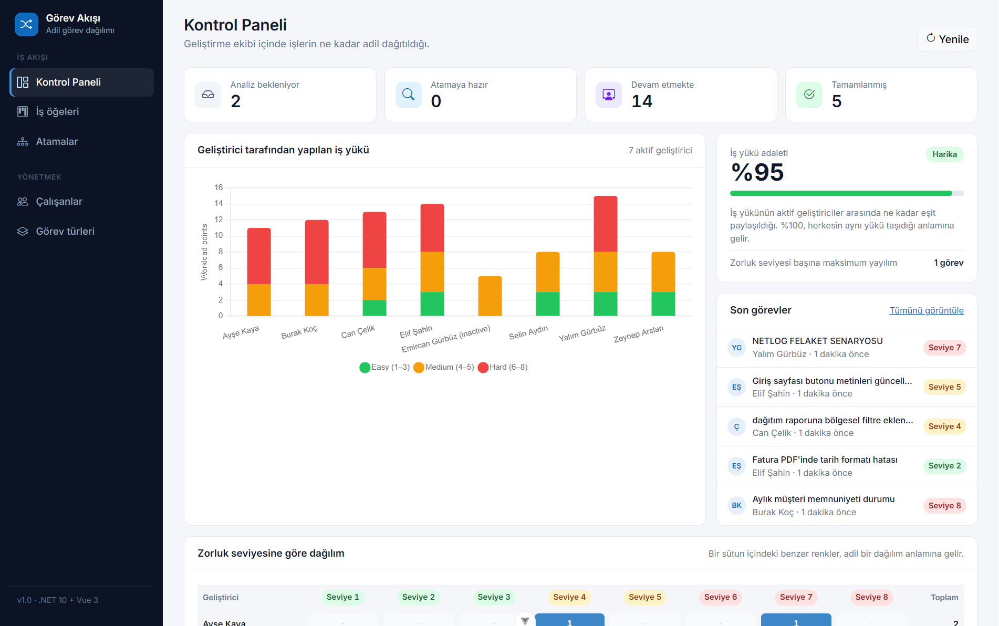
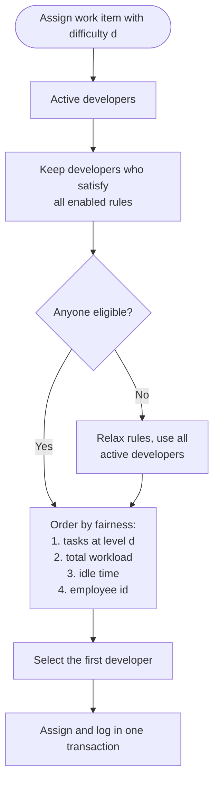
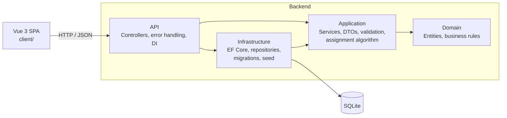
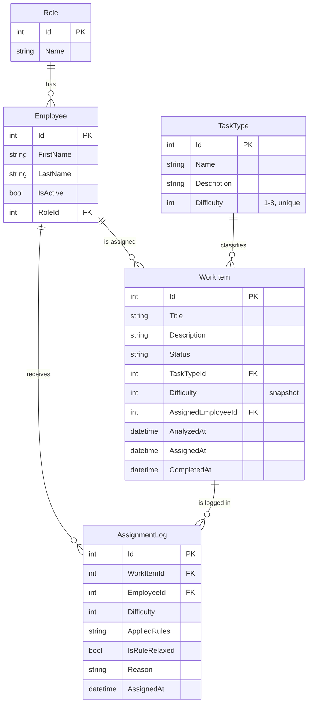
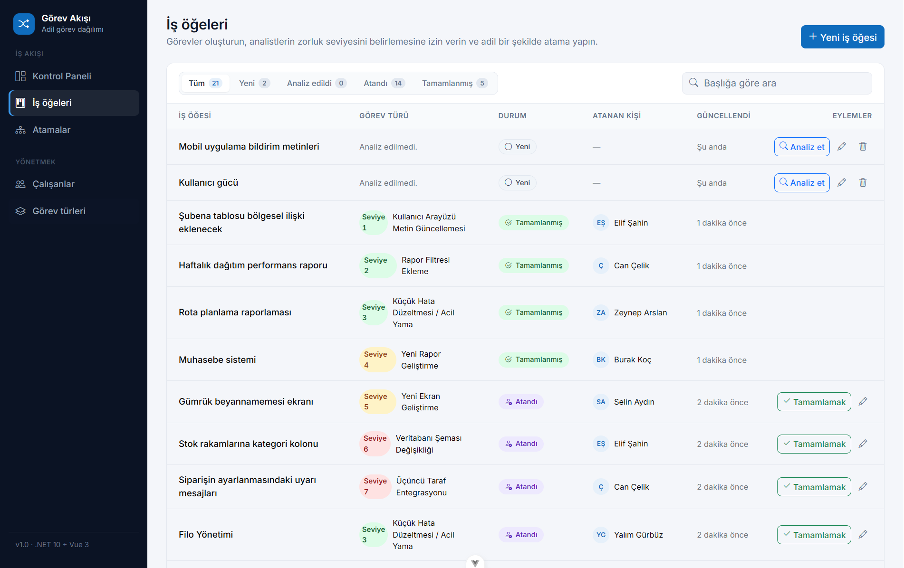
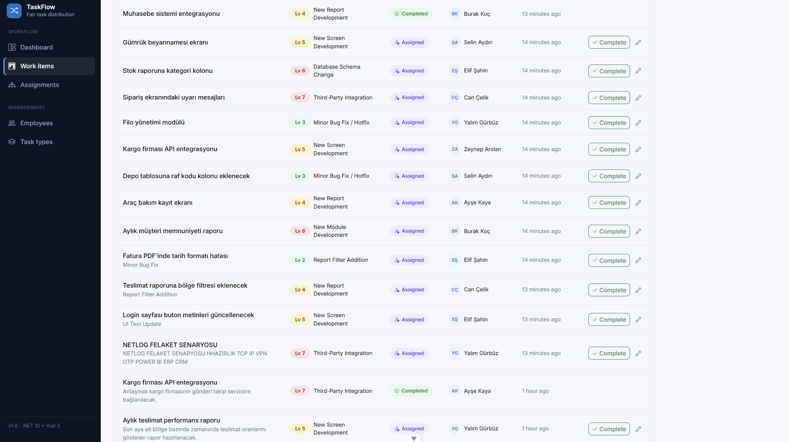
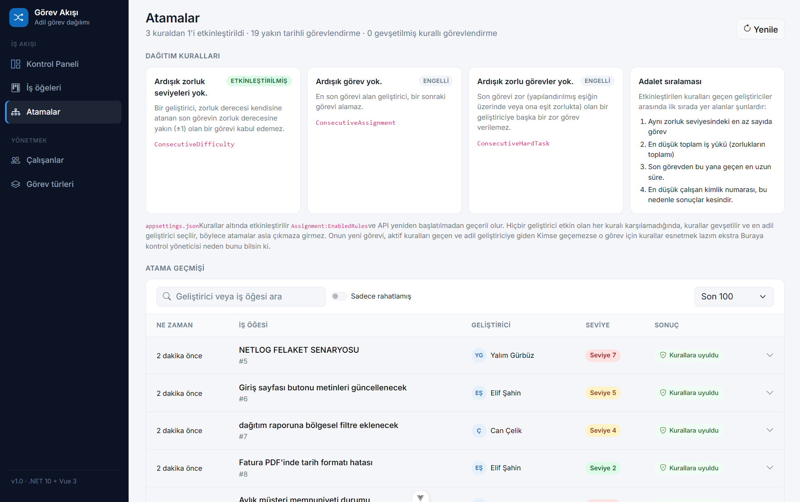
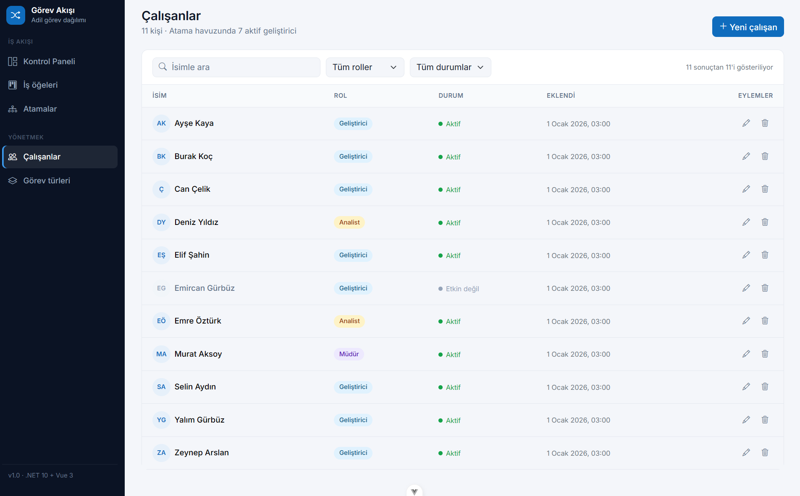
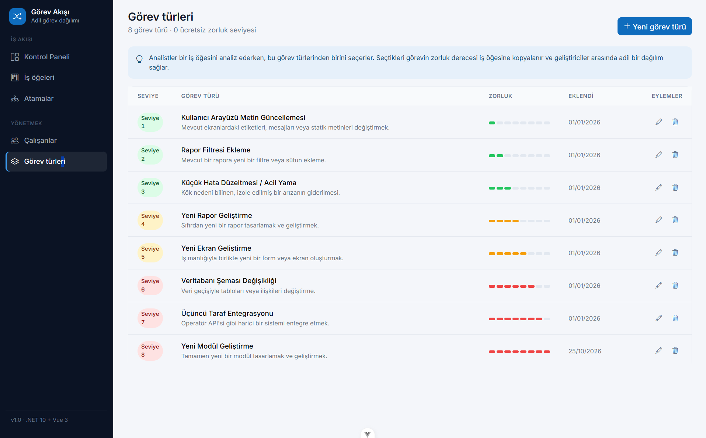
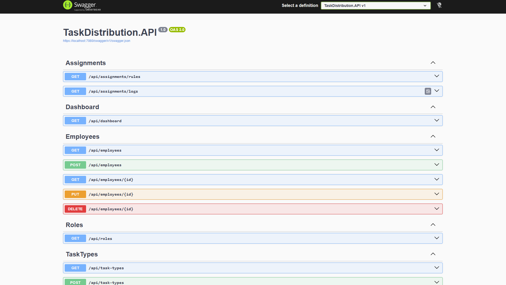

# TaskFlow · Fair Task Distribution

A web application that digitalizes the daily task flow of a software unit. Users open work items, analysts set their
difficulty by choosing a task type, and the system **automatically assigns the fairest developer** while making sure
developers never receive tasks of consecutive difficulty.

Built as a case study with **ASP.NET Core Web API (.NET 10)**, **EF Core (Code-First) + SQLite** and **Vue 3**.



---

## Contents

1. [Features](#features)
2. [Tech stack and versions](#tech-stack-and-versions)
3. [Getting started](#getting-started)
   - [Option A: Docker (one command)](#option-a-docker-one-command)
   - [Option B: Run locally](#option-b-run-locally)
4. [How to use](#how-to-use)
5. [Assignment algorithm](#assignment-algorithm)
6. [Architecture](#architecture)
7. [Data model](#data-model)
8. [API endpoints](#api-endpoints)
9. [Configuration](#configuration)
10. [Tests](#tests)
11. [Design decisions](#design-decisions)
12. [Screenshots](#screenshots)

---

## Features

- **Automatic, fair developer assignment** based on the difficulty level of each work item
- **Configurable assignment rules** implemented with the Strategy Pattern (three interpretations of the case rule)
- **Transparent decisions:** every assignment stores *why* a developer was selected
- **Fallback mechanism:** assignment never gets stuck when no developer satisfies every rule
- **Full CRUD** for employees, task types and work items, with validation and business rule checks
- **Work item lifecycle:** New → Analyzed → Assigned → Completed
- **Dashboard:** workload per developer, fairness index and a difficulty distribution heatmap
- **Assignment history** with the reason behind each decision
- **Automatic database setup:** migrations and seed data are applied on startup, no manual step required
- **50+ unit tests**, including a simulation that proves the distribution stays fair over 160 assignments

## Tech stack and versions

### Backend

| Technology | Version | Purpose |
|------------|---------|---------|
| .NET / C# | 10 (LTS) / C# 14 | Runtime and language |
| ASP.NET Core Web API | 10 | REST API with controllers |
| Entity Framework Core | 10 | ORM, Code-First with migrations |
| SQLite | via `Microsoft.EntityFrameworkCore.Sqlite` 10 | File-based database, no server needed |
| FluentValidation | 12 | Request validation |
| Swashbuckle (Swagger) | 10.3 | API documentation and test UI |
| xUnit | 2.9 | Unit tests |

### Frontend

| Technology | Version | Purpose |
|------------|---------|---------|
| Vue | 3.5 | UI framework (Composition API, `<script setup>`) |
| Vite | 8 | Dev server and build tool |
| Vue Router | 4 | Client-side routing |
| Pinia | 3 | State management (notifications) |
| Axios | 1 | HTTP client |
| Bootstrap | 5.3 (CSS only) | Layout and base styles, custom theme on top |
| Bootstrap Icons | 1 | Icons |
| Chart.js + vue-chartjs | 4 + 5 | Dashboard charts |

### Tooling

| Tool | Version |
|------|---------|
| .NET SDK | 10.0.100 or later |
| Node.js | 24 LTS (22.18+ also works) |
| Docker (optional) | Docker Desktop 4.x / Engine 24+ with Compose v2 |

> Exact package versions are pinned in the `.csproj` files and `client/package-lock.json`.

---

## Getting started

Clone the repository:

```bash
git clone https://github.com/<your-username>/TaskDistribution.git
cd TaskDistribution
```

You can run the project in two ways. **Docker is the fastest**: you don't need .NET or Node.js on your machine.

### Option A: Docker (one command)

**Requirement:** [Docker Desktop](https://www.docker.com/products/docker-desktop/)

```bash
docker compose up --build
```

The first build takes a few minutes. When it's done, open:

| What | URL |
|------|-----|
| Web application | http://localhost:8080 |
| Swagger (API) | http://localhost:5080/swagger |

The database is created and seeded automatically. It is stored in a Docker volume, so your data survives restarts.

```bash
docker compose down        # stop the containers (data is kept)
docker compose down -v     # stop and delete the database (fresh start next time)
```

> If port 8080 or 5080 is already in use on your machine, change the left-hand port in `docker-compose.yml`
> (for example `"8081:80"`).

### Option B: Run locally

**Requirements:**

- [.NET SDK 10](https://dotnet.microsoft.com/download/dotnet/10.0)
- [Node.js 24 LTS](https://nodejs.org/)

Check your versions:

```bash
dotnet --version   # 10.0.x
node -v            # v24.x (or v22.18+)
```

#### 1. Start the API

```bash
dotnet run --project src/TaskDistribution.API --launch-profile http
```

The API starts on **http://localhost:5080**. Swagger is available at http://localhost:5080/swagger.

On the first run the SQLite database file (`src/TaskDistribution.API/taskdistribution.db`) is created, all migrations
are applied and the seed data is inserted. No `dotnet ef` command is needed.

> **Visual Studio:** open `TaskDistribution.sln`, set `TaskDistribution.API` as the startup project, select the
> `http` profile and press **Ctrl+F5**.

#### 2. Start the web application

Open a second terminal:

```bash
cd client
npm ci
npm run dev
```

Open **http://localhost:5173**.

The web application reads the API address from `client/.env.development`
(`VITE_API_BASE_URL=http://localhost:5080/api`). The API allows this origin through CORS.

#### Reset the database

Stop the API and delete `src/TaskDistribution.API/taskdistribution.db`. It will be recreated with the seed data on the
next start.

### Seed data

| Data | Content |
|------|---------|
| Roles | Developer, Analyst, Manager |
| Employees | 8 developers, 2 analysts, 1 manager |
| Task types | 8 task types, each with a different difficulty from 1 to 8 |

---

## How to use

1. **Work items → New work item.** Create a task with a title and description. Its status is *New*.
2. **Analyze.** An analyst picks a task type. The difficulty of that task type is copied to the work item
   and its status becomes *Analyzed*.
3. **Assign** (or **Analyze and assign** in one step). The system selects the fairest developer and shows
   *why* that developer was chosen. The status becomes *Assigned*.
4. **Complete** the task when the developer finishes it.
5. Follow the distribution on the **Dashboard** and the full history on the **Assignments** page.

Employees and task types are managed on their own pages. An employee who has received tasks can't be deleted,
because the record is part of the distribution history. Instead, the application offers to **deactivate** them.
Inactive employees are excluded from automatic assignment.

---

## Assignment algorithm

> The full flowchart is in [docs/assignment-algorithm.md](docs/assignment-algorithm.md)
> and as an image in [docs/assignment-algorithm.png](docs/assignment-algorithm.png).

### Interpreting the rule

The case states that tasks must be distributed fairly per difficulty level, *"on condition that tasks are not
assigned to developers in consecutive difficulty"*. The sentence is ambiguous, so all three possible readings are
implemented as separate rules behind the `IAssignmentRule` interface:

| Rule | Key | Meaning | Default |
|------|-----|---------|---------|
| A | `ConsecutiveDifficulty` | A developer can't receive a task whose difficulty is adjacent (±1) to their last task. Last task 5 → 4 and 6 are not allowed. | **Enabled** |
| B | `ConsecutiveAssignment` | The developer who received the most recent task can't receive the next one. | Disabled |
| C | `ConsecutiveHardTask` | A developer whose last task was hard (≥ 6) can't receive another hard task. | Disabled |

**Rule A is enabled by default** because it is the most literal reading of the sentence. Rules can be combined and
are switched on in `appsettings.json` without changing any code. Adding a new interpretation only requires a new class
that implements `IAssignmentRule` (Open/Closed Principle).

### Steps

For a new work item with difficulty **d**:

1. **Candidate pool:** active employees with the *Developer* role.
2. **Rule filter:** keep developers who satisfy **all** enabled rules.
3. **Fairness ordering**, applied as tie breakers in this order:
   1. Fewest tasks at difficulty **d** (fairness per difficulty level)
   2. Lowest total workload (sum of difficulties of all received tasks)
   3. Longest time since the last assignment (developers without any assignment come first)
   4. Lowest employee id, so the result is always deterministic
4. **Fallback:** if nobody passes the rule filter, the rules are relaxed and the same ordering is applied to all
   active developers. The assignment is logged with `IsRuleRelaxed = true`.
5. **Persist:** the work item update and the assignment log are written in a **single transaction**.

Every assignment returns a human-readable reason, for example:

> *Ayşe Kaya was selected among 7 of 8 eligible developers (0 task(s) at level 4, total workload 0,
> no previous assignments).*



### Measuring fairness

The dashboard shows **Jain's fairness index** over the total workload of active developers:

```
J = (x₁ + x₂ + … + xₙ)² / (n · (x₁² + x₂² + … + xₙ²))
```

It is **100%** when every developer carries the same workload and **1/n** when one developer does all the work
(12.5% for 8 developers). The dashboard also shows the largest difference in task counts per difficulty level.

---

## Architecture

The backend follows a **layered (Clean / Onion) architecture**. Dependencies point inwards: the domain knows nothing
about the database, the web or any framework.



| Project | Responsibility | Depends on |
|---------|----------------|------------|
| `TaskDistribution.Domain` | Entities, enums, domain rules (`WorkItem.Analyze`, `AssignTo`, `Complete`) | – |
| `TaskDistribution.Application` | Use cases, DTOs, validators, repository interfaces, assignment rules and selector | Domain |
| `TaskDistribution.Infrastructure` | `DbContext`, Fluent API mappings, repositories, Unit of Work, migrations, seed data | Application |
| `TaskDistribution.API` | REST controllers, global exception handling, CORS, Swagger, composition root | Application, Infrastructure |
| `TaskDistribution.Tests` | Unit tests for rules, selector, fairness calculator and domain | Application, Domain |
| `client` | Vue 3 single page application | API over HTTP |

### Project structure

```
TaskDistribution/
├── src/
│   ├── TaskDistribution.Domain/
│   │   ├── Common/              BaseEntity
│   │   ├── Constants/           DifficultyLevel, RoleNames
│   │   ├── Entities/            Role, Employee, TaskType, WorkItem, AssignmentLog
│   │   ├── Enums/               WorkItemStatus
│   │   └── Exceptions/          DomainException
│   ├── TaskDistribution.Application/
│   │   ├── Abstractions/        IRepository<T>, specific repositories, IUnitOfWork
│   │   ├── Common/              NotFoundException, ConflictException
│   │   └── Features/
│   │       ├── Assignments/     Rules, Selection, Settings, assignment services
│   │       ├── Dashboard/       Statistics, FairnessCalculator
│   │       ├── Employees/       DTOs, validators, service
│   │       ├── Roles/
│   │       ├── TaskTypes/
│   │       └── WorkItems/
│   ├── TaskDistribution.Infrastructure/
│   │   └── Persistence/         DbContext, Configurations, Migrations, Repositories, Seed, Interceptors
│   └── TaskDistribution.API/
│       ├── Controllers/
│       └── ExceptionHandling/
├── tests/TaskDistribution.Tests/
├── client/                      Vue 3 application
│   └── src/
│       ├── api/                 HTTP client and one module per resource
│       ├── components/          Shared components and feature components
│       ├── stores/              Pinia stores
│       ├── utils/               Formatters and helpers
│       └── views/               Pages
├── docs/                        Flowchart and screenshots
└── docker-compose.yml
```

### Patterns and principles

| Principle / pattern | Where |
|---------------------|-------|
| **Layered architecture** | Four backend projects with inward-pointing dependencies |
| **Repository Pattern** | Generic `IRepository<T>` plus specific repositories for queries with includes |
| **Unit of Work** | `IUnitOfWork` for saving and transactions; all repositories share one scoped `DbContext` |
| **Strategy Pattern** | `IAssignmentRule` with three interchangeable rule implementations |
| **Single Responsibility** | Rules only check, the selector only selects, the service only orchestrates |
| **Open/Closed** | New rules or entity configurations are added without changing existing code |
| **Liskov Substitution** | Any `IAssignmentRule` or repository implementation can replace another |
| **Interface Segregation** | Services depend only on the repositories they use; `IUnitOfWork` doesn't expose repositories |
| **Dependency Inversion** | Application defines interfaces, Infrastructure implements them; wired up through DI |
| **Rich domain model** | `WorkItem` protects its state with private setters and guarded methods |
| **Code-First** | Fluent API configurations, migrations and seed data in `Infrastructure/Persistence` |

---

## Data model



All entities also have `CreatedAt` and `UpdatedAt`, filled automatically by an EF Core interceptor.

---

## API endpoints

All endpoints return JSON. Errors use the standard [ProblemDetails](https://www.rfc-editor.org/rfc/rfc9457) format.

| Method | Endpoint | Description |
|--------|----------|-------------|
| GET | `/api/roles` | List roles |
| GET | `/api/employees` | List employees |
| GET | `/api/employees/{id}` | Get an employee |
| POST | `/api/employees` | Create an employee |
| PUT | `/api/employees/{id}` | Update an employee (including activate / deactivate) |
| DELETE | `/api/employees/{id}` | Delete an employee without assignments |
| GET | `/api/task-types` | List task types |
| GET | `/api/task-types/{id}` | Get a task type |
| POST | `/api/task-types` | Create a task type |
| PUT | `/api/task-types/{id}` | Update a task type |
| DELETE | `/api/task-types/{id}` | Delete an unused task type |
| GET | `/api/work-items?status=` | List work items, optionally filtered by status |
| GET | `/api/work-items/{id}` | Get a work item |
| POST | `/api/work-items` | Create a work item |
| PUT | `/api/work-items/{id}` | Update title and description |
| POST | `/api/work-items/{id}/analyze` | Set the task type and difficulty |
| POST | `/api/work-items/{id}/assign` | **Assign the fairest developer** |
| POST | `/api/work-items/{id}/complete` | Complete an assigned work item |
| DELETE | `/api/work-items/{id}` | Delete a new or analyzed work item |
| GET | `/api/assignments/rules` | List assignment rules and whether they are enabled |
| GET | `/api/assignments/logs?count=` | Recent assignment history |
| GET | `/api/dashboard` | Workload statistics and fairness index |

| Status code | When |
|-------------|------|
| 400 | Validation error or domain rule violation (e.g. analyzing an assigned work item) |
| 404 | The requested record doesn't exist |
| 409 | Conflict (e.g. deleting an employee who has assignments, duplicate difficulty) |

Ready-made requests are in `src/TaskDistribution.API/TaskDistribution.API.http` (Visual Studio and VS Code can send
them directly).

---

## Configuration

`src/TaskDistribution.API/appsettings.json`:

```json
{
  "ConnectionStrings": {
    "DefaultConnection": "Data Source=taskdistribution.db"
  },
  "Assignment": {
    "EnabledRules": [ "ConsecutiveDifficulty" ],
    "HardTaskThreshold": 6
  },
  "Cors": {
    "AllowedOrigins": [ "http://localhost:5173" ]
  }
}
```

| Setting | Description |
|---------|-------------|
| `ConnectionStrings:DefaultConnection` | SQLite file. A relative path is resolved against the API project folder. |
| `Assignment:EnabledRules` | Enabled rule keys: `ConsecutiveDifficulty`, `ConsecutiveAssignment`, `ConsecutiveHardTask`. Rules can be combined. |
| `Assignment:HardTaskThreshold` | Minimum difficulty treated as "hard" by rule C. |
| `Cors:AllowedOrigins` | Origins allowed to call the API from the browser. |

Assignment settings are read through `IOptionsMonitor`, so **changes take effect while the API is running**,
without a restart. For example, to enable rules A and C:

```json
"EnabledRules": [ "ConsecutiveDifficulty", "ConsecutiveHardTask" ]
```

---

## Tests

```bash
dotnet test
```

| Test class | What it proves |
|------------|----------------|
| `ConsecutiveDifficultyRuleTests` | Adjacent difficulties are excluded, others are allowed, including the 1↔2 and 7↔8 edges |
| `ConsecutiveAssignmentRuleTests` | The developer who received the last task is excluded |
| `ConsecutiveHardTaskRuleTests` | Consecutive hard tasks are prevented and the threshold is configurable |
| `FairDeveloperSelectorTests` | Each fairness criterion, rule filtering, the fallback and the reason text |
| `DeveloperCandidateBuilderTests` | Statistics are calculated correctly from the assignment history |
| `AssignmentSimulationTests` | Over 160 assignments with 8 developers, no active rule is violated and per-difficulty spread stays ≤ 2 |
| `FairnessCalculatorTests` | Jain's fairness index and the per-level spread |
| `WorkItemTests` | The work item lifecycle and its guards |

The selector and the rules are pure classes without database or framework dependencies, so the tests need no mocks
and run in milliseconds.

---

## Design decisions

| Decision | Reason |
|----------|--------|
| **SQLite** | Runs without a database server or setup. Anyone can clone the repository and start the API. |
| **`WorkItem` instead of `Task`** | Avoids a name clash with `System.Threading.Tasks.Task`. |
| **Difficulty is copied to the work item** | Changing a task type later doesn't rewrite history or the fairness statistics. |
| **Employees are deactivated, not deleted** | Assignment history and fairness statistics stay correct. |
| **Assigned work items can't be re-analyzed or deleted** | They are part of the distribution history. |
| **Rules are configured, not hard-coded** | The ambiguous rule can be reinterpreted without code changes. |
| **Fairness statistics are calculated in memory** | Only four small fields per assignment are loaded. SQLite can't reliably translate date aggregates through EF Core, and the data volume of a software unit is small. |
| **`DateTime` (UTC) instead of `DateTimeOffset`** | SQLite can't order by `DateTimeOffset`; a value converter keeps all dates marked as UTC. |
| **`TimeProvider` instead of `DateTime.UtcNow`** | Time can be controlled in tests. |
| **No AutoMapper** | Simple, explicit mapping methods; no extra dependency (AutoMapper is now commercially licensed). |
| **Bootstrap CSS only, no Bootstrap JavaScript** | Modals and notifications are controlled by Vue instead of direct DOM manipulation. |
| **Business exceptions mapped to ProblemDetails** | Controllers stay thin; every error reaches the client in the same format. |

### Possible improvements

- Authentication and role-based authorization (analysts analyze, managers configure rules)
- Managing assignment rules from the UI, stored in the database (the `IAssignmentSettingsProvider` abstraction is ready for it)
- Pagination for work items and assignment history
- Integration tests with an in-memory SQLite database
- Real-time updates with SignalR

---

## Screenshots

| Work items | Assignment result |
|------------|-------------------|
|  |  |

| Assignments | Employees |
|-------------|-----------|
|  |  |

| Task types | Swagger |
|------------|---------|
|  |  |

---

## Author

**Emircan Gürbüz**
