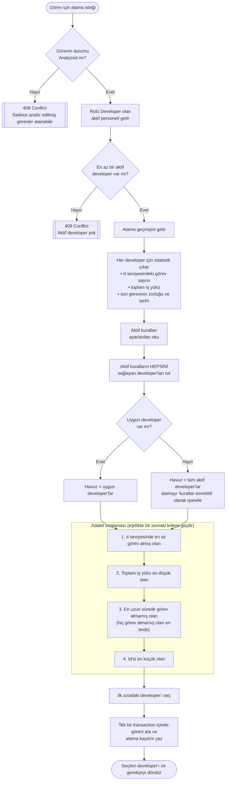
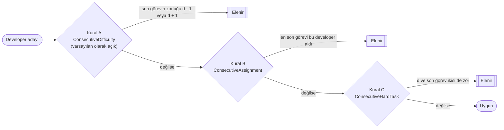

# Developer Atama Algoritması

Bu doküman, sistemin analiz edilmiş bir görev için developer'ı nasıl seçtiğini anlatır.
Algoritmanın kodu `src/TaskDistribution.Application/Features/Assignments` klasöründedir.

## Flowchart

## Kurallar

Case study'de görevlerin *"ardışık zorlukta developerlara atanmaması"* isteniyor. Bu cümle üç farklı şekilde
okunabildiği için her yorum ayrı bir kural olarak yazıldı (Strategy Pattern, `IAssignmentRule`).
Yeni görevin zorluğu **d** ile gösterilir.

| Kural | Anahtar | Cümlenin yorumu | Varsayılan |
|-------|---------|-----------------|------------|
| A | `ConsecutiveDifficulty` | Bir developer'a, son aldığı görevin zorluğuna komşu (±1) seviyede görev verilmez. Örnek: son görevi 5 ise 4 ve 6 verilemez. | Açık |
| B | `ConsecutiveAssignment` | En son görevi alan developer, bir sonraki görevi alamaz. | Kapalı |
| C | `ConsecutiveHardTask` | Son görevi zor olan developer'a yeniden zor görev verilmez. "Zor", `HardTaskThreshold` değeri ve üzerindeki zorluktur (varsayılan 6). | Kapalı |

Sadece açık olan kurallar kontrol edilir. Kapalı bir kural yukarıdaki diyagramda atlanır.
Daha önce hiç görev almamış bir developer tüm kuralları sağlamış sayılır.

## Tanımlar

| Terim | Tanım |
|-------|-------|
| Son görev | Developer'a en son atanan görev. Önce atama zamanına, eşitlikte görev Id'sine bakılır. |
| Toplam iş yükü | Developer'a şimdiye kadar atanan tüm görevlerin zorluk toplamı. Tamamlanmış görevler de dahildir. |
| d seviyesindeki görev sayısı | Developer'ın, yeni görevle aynı zorluktaki görevlerden kaç tane aldığı |

## Sıralama neden bu şekilde?

1. **d seviyesindeki görev sayısı** ilk sıradadır, çünkü case *zorluk seviyesi bazında* adil dağılım istiyor.
2. **Toplam iş yükü** genel efor dengesini sağlar. Böylece zor görevler tek bir kişide toplanmaz.
3. **Boşta geçen süre**, diğer her şey eşitken işi zamana yayar.
4. **Id** sonucu deterministik yapar: aynı girdi her zaman aynı sonucu verir. Bu da algoritmayı test edilebilir kılar.

## Fallback

Hiçbir developer açık kuralların hepsini sağlayamazsa atama işlemi kilitlenmemelidir. Örneğin 8 developer'ın hepsinin
son görevi 4 veya 6 seviyesindeyse ve yeni görev 5 seviyesindeyse, Kural A herkesi eler. Bu durumda kurallar esnetilir,
aynı adalet sıralaması tüm aktif developer'lara uygulanır ve atama kaydı `IsRuleRelaxed = true` olarak işaretlenir.

## Transaction

Geçmişin okunması, developer'ın seçilmesi, görevin güncellenmesi ve atama kaydının yazılması tek bir veritabanı
transaction'ı içinde çalışır. Adımlardan biri başarısız olursa hiçbir değişiklik kaydedilmez.
