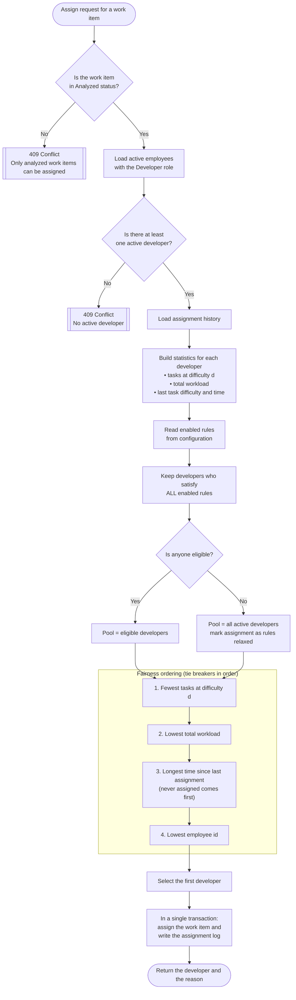
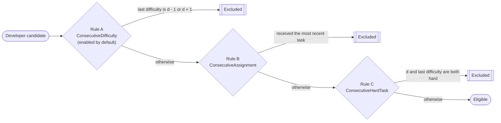

# Developer Assignment Algorithm

This document describes how the system selects a developer for an analyzed work item.
The implementation lives in `src/TaskDistribution.Application/Features/Assignments`.

## Flowchart

## Rules

The case study states that tasks must not be assigned to developers *"in consecutive difficulty"*.
The sentence can be read in three ways, so each reading is implemented as a separate rule
(Strategy Pattern, `IAssignmentRule`). The difficulty of the new work item is **d**.

| Rule | Key | Reading of the sentence | Default |
|------|-----|-------------------------|---------|
| A | `ConsecutiveDifficulty` | A developer cannot receive a task whose difficulty is adjacent (±1) to their last task. Example: last task 5, so 4 and 6 are not allowed. | Enabled |
| B | `ConsecutiveAssignment` | The developer who received the most recent task cannot receive the next one. | Disabled |
| C | `ConsecutiveHardTask` | A developer whose last task was hard cannot receive another hard task. "Hard" means difficulty ≥ `HardTaskThreshold` (default 6). | Disabled |

Only enabled rules are evaluated. A disabled rule is skipped in the diagram above.
A developer who has never received a task satisfies every rule.

## Definitions

| Term | Definition |
|------|------------|
| Last task | The work item most recently assigned to the developer (by assignment time, then by work item id). |
| Total workload | Sum of the difficulties of all work items ever assigned to the developer, completed ones included. |
| Tasks at difficulty d | Number of work items with the same difficulty as the new one that the developer has received. |

## Why this order?

1. **Tasks at difficulty d** comes first because the case asks for a fair distribution *per difficulty level*.
2. **Total workload** balances the overall effort, so one developer does not collect all hard tasks.
3. **Idle time** spreads work over time when everything else is equal.
4. **Employee id** makes the result deterministic: the same input always produces the same output, which keeps the algorithm testable.

## Fallback

If no developer satisfies every enabled rule (for example, all eight developers last received a level 4 or 6 task
and the new task is level 5), assignment must not get stuck. The rules are relaxed, the same fairness ordering is applied
to all active developers, and the assignment log is marked with `IsRuleRelaxed = true`.

## Transaction

Reading the history, selecting the developer, updating the work item and writing the assignment log run inside one
database transaction. If any step fails, nothing is saved.
